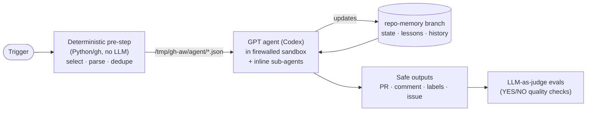

# Agentic-Workflows

A collection of **GitHub Agentic Workflows** ([`gh aw`](https://github.github.com/gh-aw/)),
all powered by **OpenAI GPT through the Codex engine**. Each workflow demonstrates a
different modern agentic technique, so the repository doubles as a working pattern
library.

| | Workflow | AI technique | Trigger | Produces |
|---|---|---|---|---|
| 🎯 | [**Goal Seeker**](.github/workflows/goal-seeker.md) | Goal contracts + **cross-run loop** (plan → act → verify → ratchet), circuit breakers, evidence-gated completion | `goal` issue · every 2h heartbeat · `/goal …` | One PR per goal, grown iteration by iteration, plus a live status comment |
| 🧬 | [**Repo Darwin**](.github/workflows/repo-darwin.md) | Evolutionary search + **Thompson-sampling bandit** + a learned "taste genome" | Weekdays | One proof-carrying improvement PR per generation |
| 🩺 | [**CI Healer**](.github/workflows/ci-healer.md) | **Reflexion** (self-correcting retry loop) + episodic **casebook memory** | A watched workflow fails | Fix PR with before/after proof, or a deduplicated incident issue |
| ⚖️ | [**PR Tribunal**](.github/workflows/pr-tribunal.md) | **Multi-agent adversarial debate** (prosecutor and defender sub-agents) + judge re-verification | `/tribunal` comment or `tribunal` label on a PR | A PR review containing only *executed, reproduced* findings |
| 🔭 | [**Deep Research**](.github/workflows/deep-research.md) | **Plan-and-execute** + parallel scout sub-agents + skeptic fact-checking + **iterative deepening** + a knowledge base | `/research <question>` | A cited report with calibrated confidence, saved to the knowledge base |
| 🗳️ | [**Triage Council**](.github/workflows/triage-council.md) | **Self-consistency ensemble voting** with confidence-gated actions | New issue | Majority-vote labels and a transparent vote record |
| 📊 | [Daily Repo Status](.github/workflows/daily-repo-status.md) | Baseline report (original sample, Claude engine) | Manual | Status issue |

## The architecture every workflow shares



- **Deterministic first.** Anything that *can* be computed (which goal to advance, the
  failure signature, bandit sampling, fitness) is computed in auditable Python before
  the model runs. The model spends its effort on judgment.
- **Memory that persists.** State lives on `memory/*` git branches, so you can browse
  what each agent knows: `memory/goals`, `memory/darwin`, `memory/ci-casebook`, and
  `memory/research-kb`.
- **Evidence or it didn't happen.** Every workflow imports
  [`shared/agent-principles.md`](.github/workflows/shared/agent-principles.md): claims
  need command output from the current run, and untrusted content is treated as data.
- **Bounded by construction.** The agent can only write through gh-aw *safe outputs*
  with caps, label allowlists, branch allowlists, and protected-file policies. Each
  workflow also ships **evals**, where a judge model scores every run on YES/NO quality
  questions.

## Loops and goals: how the looping works

| Loop | Scope | Mechanism | Stops when |
|---|---|---|---|
| **Goal loop** (Goal Seeker) | Across runs, for days | A fuzzy-scheduled heartbeat plus [`scheduler.py`](.github/goal-seeker/scheduler.py), which picks one goal round-robin; state is kept in `memory/goals` | All success criteria pass *with evidence*, the budget is spent, the same failure signature repeats twice, or a human runs `/goal pause` |
| **Reflexion loop** (CI Healer) | Within one run | Reproduce → hypothesise → patch → verify → write a reflection; the next attempt must read it | The fix is verified, there are 4 attempts, the same error twice, or the root cause is outside the repo |
| **Deepening loop** (Deep Research) | Within one run | Scouts → skeptic → confidence score → targeted follow-up queries | Every sub-question is at least medium confidence, or 3 rounds |
| **Evolution loop** (Repo Darwin) | Across runs | Your merges and closes are the reward signal for a Bayesian bandit | Never; carrying capacity is 3 open PRs |

### Set a goal in 30 seconds

1. **New issue → 🎯 Goal for Goal Seeker.** Fill in the objective and give each success
   criterion a command in `backticks`, for example ``- [ ] Tests pass: `python -m pytest -q` ``.
2. On the next heartbeat (or *Actions → Goal Seeker → Run workflow*), the agent checks
   that the contract is *verifiable*. If it isn't, it proposes a better one. Then it
   plans milestones and starts iterating on a single `goal/<n>` PR.
3. Steer it from the issue with `/goal focus on tests first`, `/goal pause`,
   `/goal resume`, or `/goal status`.

## Setup

1. **Secret:** add `OPENAI_API_KEY`
   (`gh aw secrets set OPENAI_API_KEY --value "sk-..."`, or *Settings → Secrets and variables → Actions*).
2. **Allow PRs from Actions:** *Settings → Actions → General → "Allow GitHub Actions to create and approve pull requests"*.
3. **Compile:** `gh extension install github/gh-aw && gh aw compile`, then commit the
   generated `*.lock.yml` files. Only the lock files run; the `.md` files are the source.
4. **Try them:**
   - `gh aw run repo-darwin`: generation 1.
   - Open a goal issue from the template, then `gh aw run goal-seeker`.
   - Comment `/research what are the trade-offs of Thompson sampling vs UCB?` on any issue.
   - Comment `/tribunal` on any PR.
   - Open any issue to see the Triage Council vote.
   - CI Healer wakes up by itself the next time *Run Python Script* fails.

Models: every workflow uses `openai/gpt-6.1-sol` except Triage Council, which uses the
cheaper `gpt-6.1-terra`. Evals use `openai/gpt-6-luna`. Change the `model:` line in any
workflow and recompile.

## Layout

```
.github/
├── workflows/
│   ├── *.md                     # agentic workflow sources (compile → *.lock.yml)
│   └── shared/agent-principles.md
├── darwin/natural_selection.py  # fitness + Thompson sampling
├── goal-seeker/scheduler.py     # goal selection, contract parsing, circuit breaker
├── ci-healer/collect_failure.py # failure evidence + stable failure keys
└── ISSUE_TEMPLATE/goal.yml      # goal contract form
```

Each Python helper runs offline against fixtures (`DARWIN_FIXTURE`, `GOAL_FIXTURE`,
`CI_FIXTURE_DIR`); see the docstring at the top of each file.
